<div align="center">

# 🔥 Programmers Streak Badge

**프로그래머스 점수 · 랭킹 · 푼 문제 수**와 **매일 이어 온 연속 풀이 기록**을<br>
GitHub 프로필에 보여주는 배지

<br>


<sub>이 저장소의 실제 배지입니다. 문제를 풀면 자동으로 바뀝니다.</sub>

<br><br>

[설치 가이드 바로 가기 ↓](#-설치-가이드)

</div>

<br>

## ✨ 특징

- **연속 풀이(스트릭) + 잔디** — 백준허브가 올린 기록으로 오늘까지 며칠 연속 풀었는지, 최근 16주 동안 어떻게 풀었는지 보여줍니다. 안 푼 날은 주황 테두리로 표시됩니다.
- **점수 · 랭킹 · 푼 문제 수** — 프로그래머스 계정 정보를 그대로 가져옵니다. (선택)
- **한국 시간 기준** — 오늘 아직 안 풀었어도 **자정 전까지는 연속 기록이 끊기지 않습니다.**
- **자동 갱신** — 매시간 갱신되고, 설정하면 문제를 풀자마자 1~2분 안에 바뀝니다.
- **서버 불필요** — GitHub Actions만으로 무료로 동작합니다.
- **설치 10분** — 코드를 고칠 필요 없이 버튼 클릭과 복사·붙여넣기만 하면 됩니다.

<br>

## 📊 배지 읽는 법

<table>
<tr>
<td width="50%">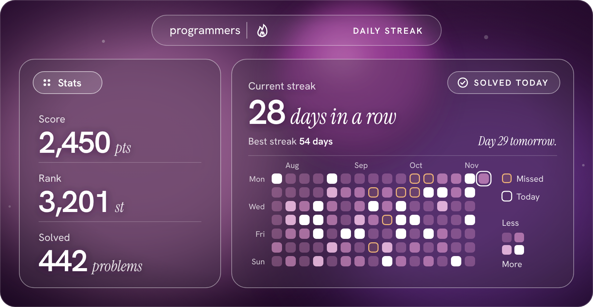</td>
<td width="50%">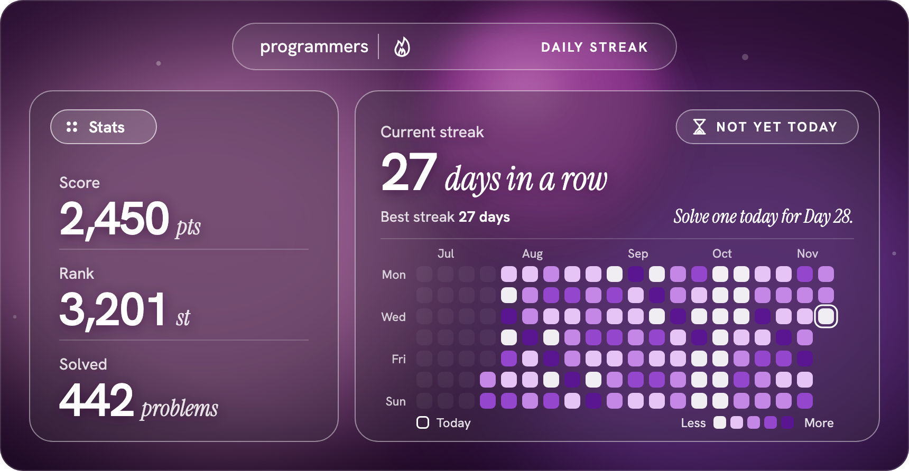</td>
</tr>
<tr>
<td align="center"><sub>오늘 이미 푼 날</sub></td>
<td align="center"><sub>오늘 아직 안 푼 날 (모래시계가 깜빡여요)</sub></td>
</tr>
</table>

| 영역 | 보여주는 내용 |
|:--|:--|
| 왼쪽 **Stats** | 프로그래머스 **점수**(Score), 전체 **랭킹**(Rank), **해결한 문제 수**(Solved) |
| 오른쪽 위 | **현재 연속 일수**, **최장 기록**(Best streak), 오늘 상태와 응원 문구 |
| 오른쪽 잔디 | 최근 16주 동안 날마다 푼 문제 수 |

| 표시 | 의미 |
|:--:|:--|
| ✓ `SOLVED TODAY` | 오늘 이미 풀었어요 |
| ⧗ `NOT YET TODAY` | 오늘 아직 안 풀었어요. 자정 전에 풀면 연속 기록이 이어집니다 |
| 분홍 → 흰색 칸 | 그날 푼 문제 수 (1 · 2 · 3–4 · 5개 이상). 흰색일수록 많이 푼 날 |
| 주황 테두리 칸 | 안 푼 날 |
| 흰 테두리 칸 | 오늘 |
| `—` | 아직 값을 가져오지 못했어요 ([자주 묻는 질문](#-자주-묻는-질문) 참고) |

<br>

## ✅ 시작하기 전에

**준비물**

- [ ] GitHub 계정
- [ ] 크롬 브라우저
- [ ] **이메일과 비밀번호로 로그인**하는 프로그래머스 계정 (점수·랭킹을 보여주고 싶을 때만)

> ⚠️ 구글·카카오·깃허브 같은 **소셜 로그인만** 쓰는 계정이라면 점수·랭킹은 `—` 로 나옵니다. 연속 기록과 잔디는 정상으로 보여요.

**백준허브 연결하기**

배지는 [백준허브(BaekjoonHub)](https://github.com/BaekjoonHub/BaekjoonHub)가 GitHub에 올린 풀이 기록으로 잔디와 연속 기록을 계산합니다. 이미 쓰고 있다면 아래 그림처럼 폴더가 있는지만 확인하고 넘어가세요.

1. [크롬 웹 스토어의 백준허브 페이지](https://chromewebstore.google.com/detail/ccammcjdkpgjmcpijpahlehmapgmphmk)에서 
2. 브라우저 오른쪽 위 백준허브 아이콘 → 
3. 풀이를 올릴 저장소를 새로 만들거나 고른 뒤 
4. 프로그래머스에서 아무 문제나 하나 풀어 봅니다.

<p align="center">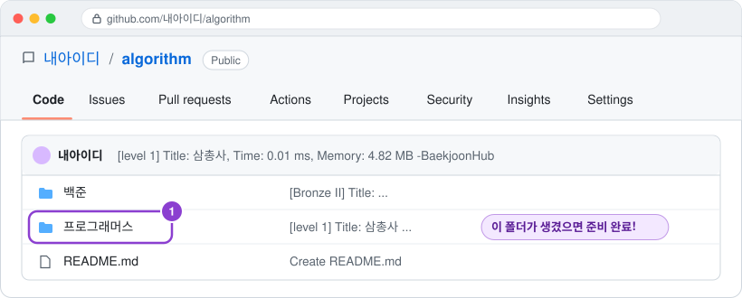</p>

이 가이드에서는 이 저장소를 **풀이 저장소**라고 부릅니다. 저장소 이름(예: `내아이디/algorithm`)을 메모해 두세요.

> 💡 백준허브는 새 저장소를 **비공개(Private)** 로 만드는 게 기본값입니다. 비공개라면 설치 2단계가 필요해요.

<br>

## 🚀 설치 가이드

> 약 10분이면 끝납니다. 순서대로 따라 하세요.<br>
>  처럼 생긴 **보라색 버튼**은 실제 화면에서 **누를 곳**이고, 그림 속 **보라색 번호**는 누르는 순서입니다.

<br>

### 1단계 · 템플릿으로 내 저장소 만들기

이 페이지 오른쪽 위의  → 

<p align="center">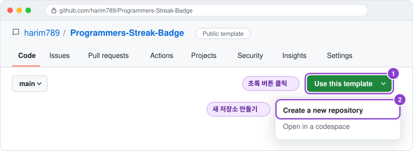</p>

이름을 `programmers-streak-badge` 로 정하고, 공개 범위는 반드시 **Public**으로 둔 뒤 

<p align="center">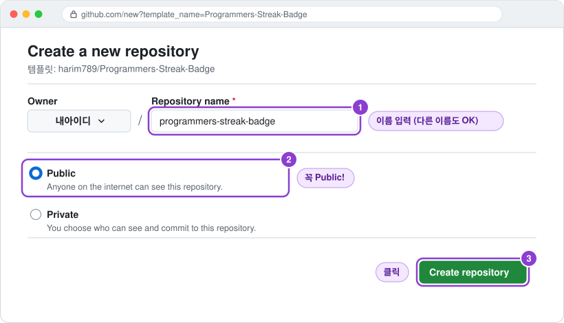</p>

> ⚠️ **Private**으로 만들면 다른 사람이 내 프로필에서 배지를 볼 수 없습니다.

✋ **여기서부터는 방금 만든 내 저장소에서 진행합니다.**

<br>

### 2단계 · 풀이 저장소 읽기 토큰 만들기 <sub>(풀이 저장소가 비공개일 때만)</sub>

풀이 저장소가 **Public이면 3단계로 건너뛰세요.**
비공개라면 배지가 풀이 기록을 **읽기만** 할 수 있는 열쇠(토큰)가 필요합니다.

GitHub 오른쪽 위 내 프로필 사진 →  → 왼쪽 맨 아래  →  →  → 

<p align="center">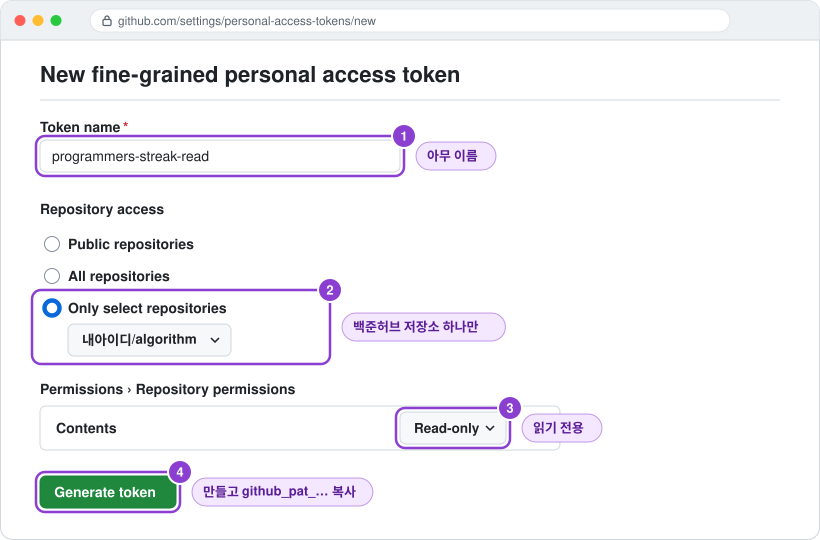</p>

| 항목 | 입력값 |
|:--|:--|
| Token name | 아무 이름 (예: `programmers-streak-read`) |
| Repository access |  → **풀이 저장소 하나만** |
| Permissions → Repository permissions → **Contents** | `Read-only` |

> ⚠️ 만들어진 토큰(`github_pat_...`)은 **한 번만** 보입니다. 바로 복사해 두세요. 만료되면 새로 만들어 3단계에서 같은 이름으로 다시 등록하면 됩니다.

<br>

### 3단계 · 비밀값(Secrets) 등록하기

비밀번호와 토큰은 **Secrets**에 넣습니다. 여기 넣은 값은 나를 포함해 **아무도 다시 볼 수 없고**, 자동 실행할 때만 쓰입니다.

내 배지 저장소에서  →  →  → 

<p align="center">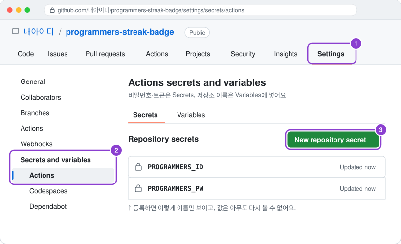</p>

**Name**과 **Secret**을 입력하고  — 아래 표의 값마다 한 번씩 반복합니다.

<p align="center">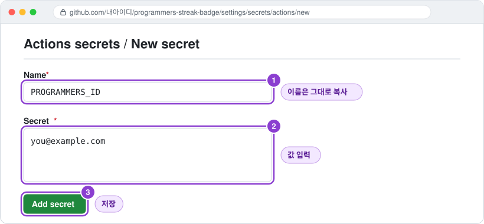</p>

| Name (그대로 복사) | Secret에 넣을 값 | 언제 필요? |
|:--|:--|:--|
| `PROGRAMMERS_ID` | 프로그래머스 로그인 **이메일** | 점수·랭킹을 보여주고 싶을 때 |
| `PROGRAMMERS_PW` | 프로그래머스 **비밀번호** | 점수·랭킹을 보여주고 싶을 때 |
| `ALGO_REPO_TOKEN` | 2단계에서 복사한 `github_pat_...` | 풀이 저장소가 **비공개**일 때 |

> 💡 소셜 로그인 계정이거나 비밀번호를 맡기고 싶지 않다면 `PROGRAMMERS_ID`, `PROGRAMMERS_PW`는 건너뛰어도 됩니다. 연속 기록과 잔디는 그대로 동작해요.

<br>

### 4단계 · 풀이 저장소 이름 알려주기

같은 화면에서  탭 →  → 입력 후 

<p align="center">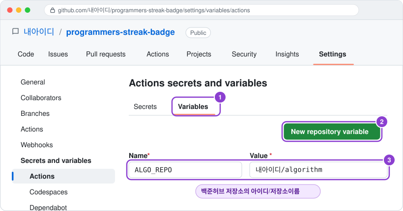</p>

| Name | Value | 예시 |
|:--|:--|:--|
| `ALGO_REPO` | 풀이 저장소의 `아이디/저장소이름` | `내아이디/algorithm` |

> ⚠️ **Secrets 탭이 아니라 Variables 탭**입니다. 저장소 이름은 비밀이 아니라서 Variables에 넣어요.

<br>

### 5단계 · 첫 배지 만들기

자동 실행은 매시간 돌지만, 처음 한 번은 직접 실행해서 잘 되는지 확인합니다.

 탭 → 왼쪽  → 오른쪽  → 펼쳐진 창의 

<p align="center">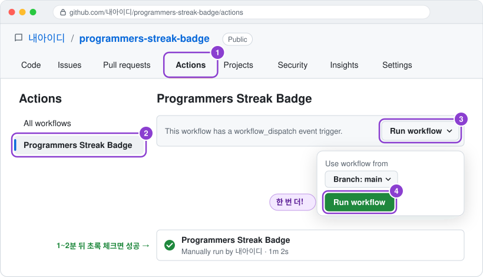</p>

> ✅ 1~2분 뒤 **초록색 체크**가 뜨고, 저장소에 `assets/programmers-streak.svg` 파일이 새로 바뀌었으면 성공입니다.<br>
> ❌ 빨간 X가 떴다면 [자주 묻는 질문](#-자주-묻는-질문)을 확인하세요.

<br>

### 6단계 · 프로필에 배지 붙이기

프로필 저장소(`내아이디/내아이디`)의 `README.md` 를 열고 연필 모양  을 누른 뒤, 원하는 위치에 아래 코드를 붙여넣습니다. **`내아이디`** 만 바꾸면 됩니다.

```html
<p align="center">
  
</p>
```

<p align="center">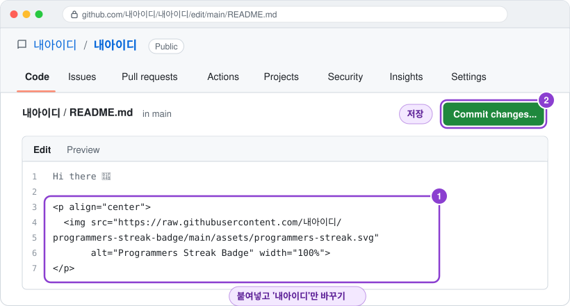</p>

 → 확인 창의 

> 💡 프로필 저장소가 없다면 저장소 이름을 **내 아이디와 똑같이** 만들고 Public으로 생성하세요. GitHub가 그 저장소의 README를 프로필에 보여줍니다.<br>
> 💡 1단계에서 저장소 이름을 바꿨다면 주소의 `programmers-streak-badge` 부분도 바꿔 주세요.<br>
> 💡 배지를 조금 작게 하려면 `width="100%"` 를 `width="640"` 처럼 바꾸세요.

<br>

**🎉 끝! 이제 프로필에 배지가 보이고, 매시간 자동으로 바뀝니다.**

<br>

## ⚡ (선택) 풀자마자 바로 갱신하기

기본은 **매시간** 갱신입니다. 문제를 풀자마자 1~2분 안에 바뀌게 하려면, 풀이 저장소에 새 기록이 올라올 때 배지 저장소를 깨우는 작은 자동화를 추가합니다.

**① 배지 저장소를 깨울 수 있는 토큰 만들기**

2단계와 같은 화면에서 토큰을 하나 더 만듭니다. 이번에는 값이 다릅니다.

| 항목 | 입력값 |
|:--|:--|
| Token name | 아무 이름 (예: `programmers-streak-dispatch`) |
| Repository access |  → **배지 저장소** (`programmers-streak-badge`) |
| Permissions → **Contents** | `Read and write` |

**② 풀이 저장소에 토큰 등록하기**

이번에는 **풀이 저장소**에서 3단계와 같은 방법으로 Secret을 등록합니다.

| Name | Secret |
|:--|:--|
| `BADGE_DISPATCH_TOKEN` | ①에서 복사한 토큰 |

> ⚠️ Name은 **반드시 `BADGE_DISPATCH_TOKEN`** 그대로 입력하세요. ①의 Token name과는 별개입니다. 이름이 다르면 토큰이 전달되지 않아 갱신되지 않습니다.

**③ 풀이 저장소에 파일 추가하기**

**풀이 저장소** 첫 화면에서  → 

<p align="center">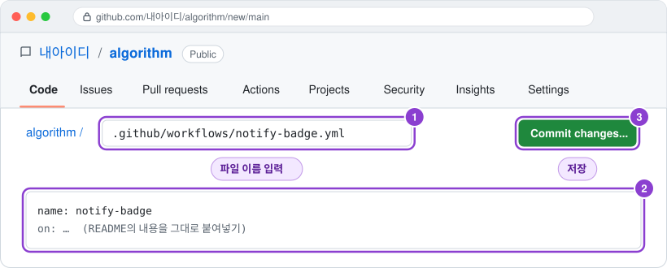</p>

파일 이름에 `.github/workflows/notify-badge.yml` 을 입력하고 아래 내용을 붙여넣은 뒤  → 
**`내아이디`** 만 바꾸면 됩니다. (1단계에서 저장소 이름을 바꿨다면 `programmers-streak-badge` 도 바꿔 주세요.)

```yaml
name: notify-badge
on:
  push:
    branches: [main]
jobs:
  dispatch:
    runs-on: ubuntu-latest
    steps:
      - run: |
          curl -sS --fail-with-body -X POST \
            -H "Authorization: Bearer ${{ secrets.BADGE_DISPATCH_TOKEN }}" \
            -H "Accept: application/vnd.github+json" \
            https://api.github.com/repos/내아이디/programmers-streak-badge/dispatches \
            -d '{"event_type":"solved"}'
```

> 💡 풀이 저장소에 이미 다른 배지용 워크플로가 있다면, 그 파일에 이어 붙이지 말고 **새 파일로** 만드세요.<br>
> ✅ 문제를 하나 푼 뒤 배지 저장소의 `Actions` 탭에 새 실행이 생기면 연결 완료입니다.<br>
> ❌ 풀이 저장소의 `notify-badge` 실행이 빨간색으로 실패하고 `Bad credentials` 가 보이면, ②의 Secret 이름이나 토큰 값을 확인하세요.

<br>

## ⚙️ 옵션

필요할 때만 배지 저장소의 `Settings` → `Secrets and variables` → `Actions` 에서 추가합니다.

| 이름 | 종류 | 설명 | 기본값 |
|:--|:--:|:--|:--:|
| `ALGO_REPO` | Variable | 풀이 저장소 `아이디/저장소이름` | **필수** |
| `PROGRAMMERS_ID` / `PROGRAMMERS_PW` | Secret | 점수·랭킹·푼 문제 수 가져오기 | 없으면 `—` |
| `ALGO_REPO_TOKEN` | Secret | 풀이 저장소가 **비공개**일 때 읽기용 토큰 | - |
| `PLATFORM_DIRS` | Variable | 잔디에 셀 폴더. 백준 기록도 합치려면 `프로그래머스,백준` | `프로그래머스` |

<br>

## ❓ 자주 묻는 질문

<details>
<summary><b>배지 이미지가 깨져 보여요</b></summary>
<br>

- 주소의 **아이디**와 **저장소 이름**이 맞는지 확인하세요.
- 5단계를 실행하지 않았다면 배지 파일이 아직 내 데이터로 만들어지지 않았습니다.
- 배지 저장소는 **Public**이어야 합니다.
</details>

<details>
<summary><b>Score · Rank · Solved가 <code>—</code> 로 나와요</b></summary>
<br>

- 3단계의 `PROGRAMMERS_ID`(이메일), `PROGRAMMERS_PW` 가 **배지 저장소의 Actions Secrets**에 들어갔는지 확인하세요. 풀이 저장소나 Codespaces 쪽에 넣으면 읽지 못합니다.
- 값이 틀린 것 같으면 같은 이름으로 다시 등록하면 덮어써집니다.
- 프로그래머스 사이트 사정으로 잠깐 실패하면 **마지막으로 성공한 값**을 그대로 보여줍니다. 한 번도 성공한 적이 없을 때만 `—` 가 나옵니다.
- 소셜 로그인 계정이라면 프로그래머스 계정 설정에서 이메일 로그인용 비밀번호를 만들 수 있는지 확인해 보세요.
</details>

<details>
<summary><b>Actions에서 빨간 X가 떴어요</b></summary>
<br>

실행 기록을 눌러 어느 단계에서 멈췄는지 보세요.

- **`Check settings`** — `ALGO_REPO 변수를 등록하세요` 가 보이면 4단계를 안 한 것입니다. 템플릿으로 저장소를 만든 직후에는 4단계 전까지 매시간 실행이 이 오류로 실패하는데, 정상이에요.
- **`Checkout algorithm repo`** — `ALGO_REPO` 철자를 확인하세요. 풀이 저장소가 비공개라면 `ALGO_REPO_TOKEN`(2단계)이 있는지, 토큰에 그 저장소가 선택됐는지 확인하세요.
- **`Commit if changed`** (권한 오류 403) — 배지 저장소에서  → 왼쪽  →  → 아래 **Workflow permissions**에서  →  후 다시 실행하세요.
</details>

<details>
<summary><b>잔디가 비어 있거나 연속 기록이 0이에요</b></summary>
<br>

- 풀이 저장소 안에 `프로그래머스` 폴더가 있는지 확인하세요.
- 오늘 아직 안 풀었고 어제도 안 풀었다면 0이 맞습니다. 최장 기록(Best streak)은 그대로 남아요.
- 백준허브를 쓰기 전에 푼 문제는 기록이 없어서 잔디에 나오지 않습니다. 대신 **Solved 숫자에는 포함**돼요.
</details>

<details>
<summary><b>문제를 풀었는데 배지가 그대로예요</b></summary>
<br>

- 기본 갱신 주기는 1시간입니다. 바로 보려면 5단계처럼 직접 실행하거나 [풀자마자 갱신](#-선택-풀자마자-바로-갱신하기)을 설정하세요.
- GitHub가 이미지를 몇 분간 캐시합니다. 잠시 후 강력 새로고침(<kbd>Ctrl</kbd>+<kbd>F5</kbd> / <kbd>Cmd</kbd>+<kbd>Shift</kbd>+<kbd>R</kbd>) 해 보세요.
- 백준허브가 풀이 저장소에 실제로 커밋했는지 확인하세요.
</details>

<details>
<summary><b>자동 실행이 멈췄어요</b></summary>
<br>

GitHub는 60일 동안 활동이 없는 저장소의 예약 실행을 끕니다. 이 배지는 값이 바뀔 때마다 커밋하므로 꾸준히 풀고 있다면 문제없어요.
멈췄다면 `Actions` 탭 상단 안내에 따라 다시 켜고 5단계를 실행하세요.
</details>

<details>
<summary><b>원본 템플릿이 업데이트되면 어떻게 받나요?</b></summary>
<br>

템플릿으로 만든 저장소는 원본과 연결되어 있지 않아 자동으로 받을 수 없습니다. 이 저장소의 `streak/` 폴더와 `.github/workflows/programmers-streak.yml` 파일을 내 저장소에 덮어쓰면 됩니다.
</details>

<br>

## 🔧 동작 원리

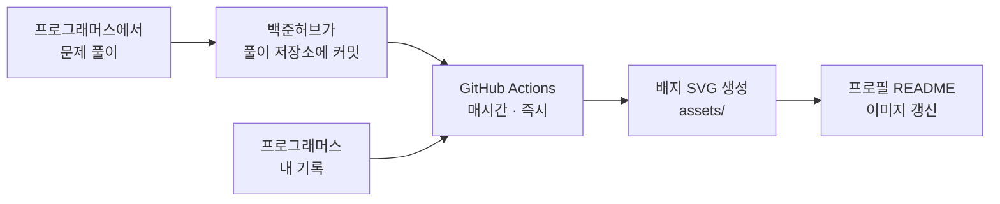

<details>
<summary>자세히 보기</summary>
<br>

- **잔디 · 연속 기록**: 풀이 저장소 `프로그래머스/…/<번호>. <제목>/` 폴더의 커밋 기록과 `README.md`의 `제출 일자`로 날짜별 푼 문제 수를 셉니다. 같은 날 같은 문제를 여러 번 제출해도 1문제로 셉니다.
- **점수 · 랭킹 · 푼 문제 수**: 프로그래머스에 로그인해서 웹사이트가 내부적으로 쓰는 주소(`/api/v1/users/record`)에서 읽습니다. 실패하면 마지막 성공값을 씁니다.
- **날짜 기준**: 모두 한국 시간(KST). 오늘 안 풀었으면 어제부터 거꾸로 세서, 자정 전까지는 연속 기록이 유지됩니다.
- **갱신 시점**: 매시 7분, 자정 직후(00:05 KST), `Run workflow`를 눌렀을 때, 풀이 저장소에서 신호가 왔을 때.
- **결과물**: `assets/programmers-streak.svg`(배지), `streak/data/`(마지막 성공값 캐시). 내용이 바뀌었을 때만 커밋합니다.
- **템플릿 복사본 보호**: 캐시에는 주인 정보(`ALGO_REPO`, 프로그래머스 ID 해시)가 함께 저장돼서, 템플릿으로 복사한 저장소에서는 원래 주인의 점수가 보이지 않습니다.

</details>

<details>
<summary>로컬에서 실행하기 (개발자용)</summary>
<br>

Python 3.11 이상만 있으면 됩니다. 외부 패키지는 쓰지 않습니다.

```bash
# 내 풀이 저장소로 배지 만들기 (점수 없이)
git clone https://github.com/내아이디/algorithm.git algo
ALGO_REPO=내아이디/algorithm python3 streak/main.py   # → assets/programmers-streak.svg

# 테스트
python3 -m unittest

# 설치 가이드 그림 다시 만들기
python3 tools/make_guide.py
```

</details>

<br>

## 🔒 보안 안내

- 프로그래머스 비밀번호는 **내 저장소의 Secrets**에만 저장되고, 코드·실행 기록(로그)·커밋 어디에도 남지 않습니다.
- 토큰은 꼭 필요한 저장소 하나, 꼭 필요한 권한만 주도록 안내했습니다.
- 점수·랭킹은 프로그래머스가 **공식으로 공개한 API가 아닌** 주소에서 가져옵니다. 프로그래머스가 사이트를 바꾸면 갑자기 `—` 로 바뀔 수 있어요.
- 걱정된다면 `PROGRAMMERS_ID`, `PROGRAMMERS_PW`를 등록하지 않아도 됩니다. 연속 기록과 잔디는 그대로 동작합니다.

<br>

## 📄 라이선스 · 크레딧

[MIT](LICENSE) · 프로그래머스(그렙)와 관련 없는 개인 프로젝트입니다.

- 점수·랭킹을 가져오는 방식은 [tomy8964/Programmers_Badge_Generator](https://github.com/tomy8964/Programmers_Badge_Generator)와 [libtv/github-programmers-rank](https://github.com/libtv/github-programmers-rank)를 참고했습니다.
- 풀이 기록은 [백준허브(BaekjoonHub)](https://github.com/BaekjoonHub/BaekjoonHub)가 올려준 커밋을 사용합니다.
- 글꼴: [Hanken Grotesk](https://github.com/marcologous/hanken-grotesk), [Instrument Serif](https://github.com/Instrument/instrument-serif) — SIL Open Font License 1.1 ([사본](streak/fonts/))
